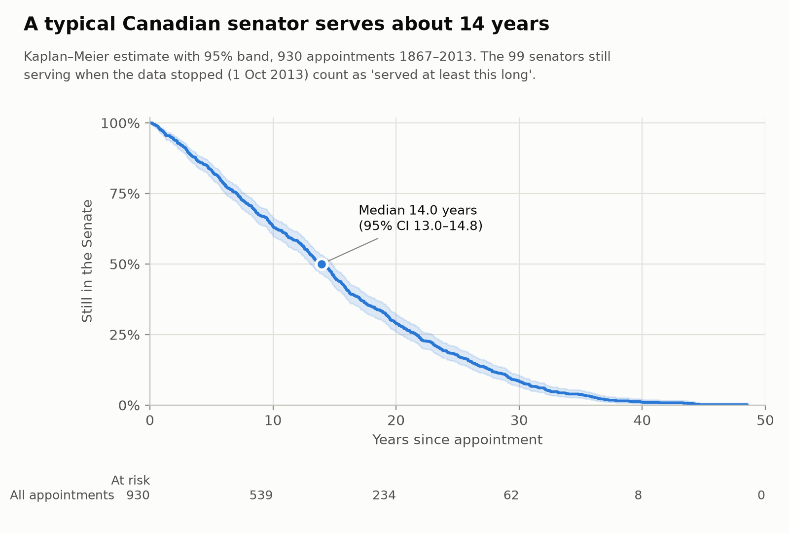
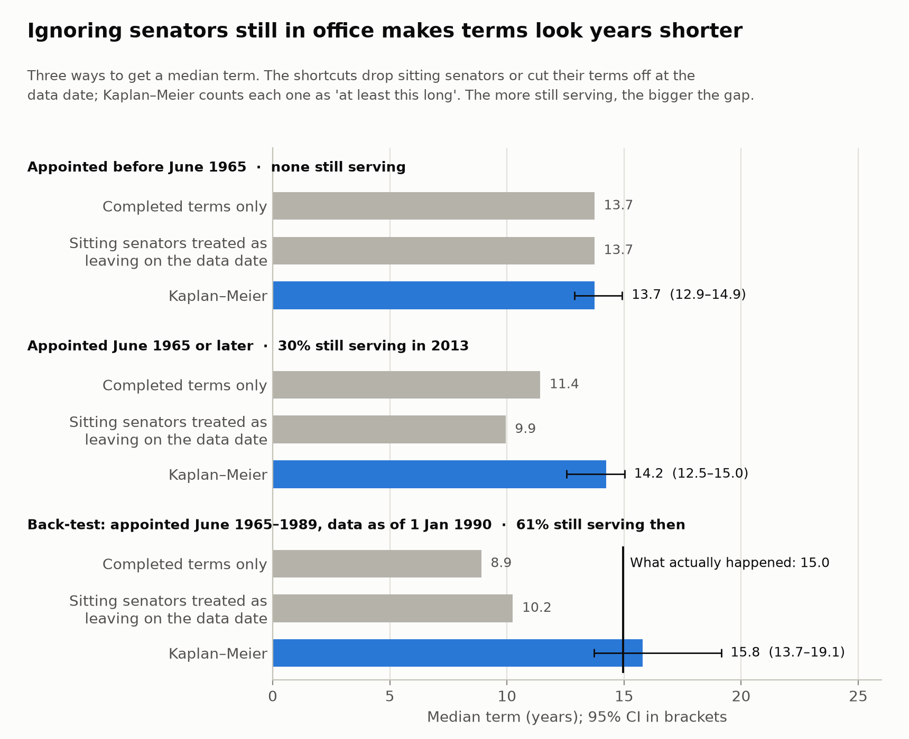
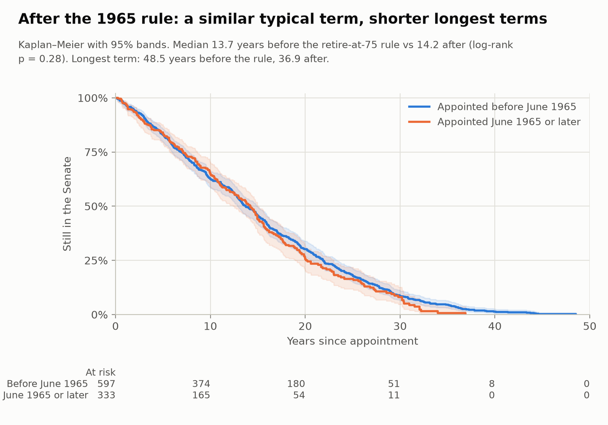
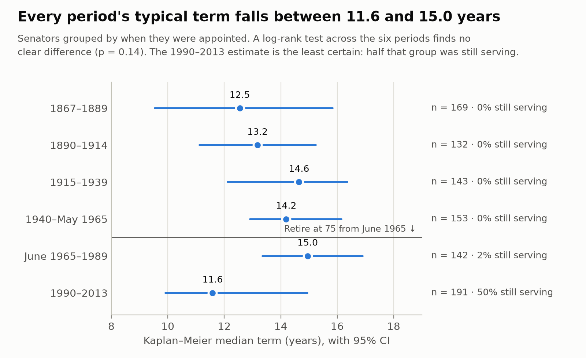
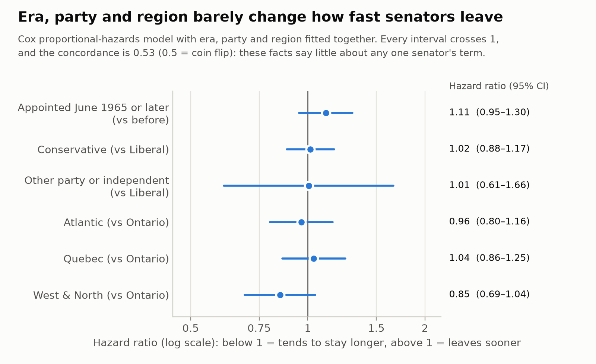
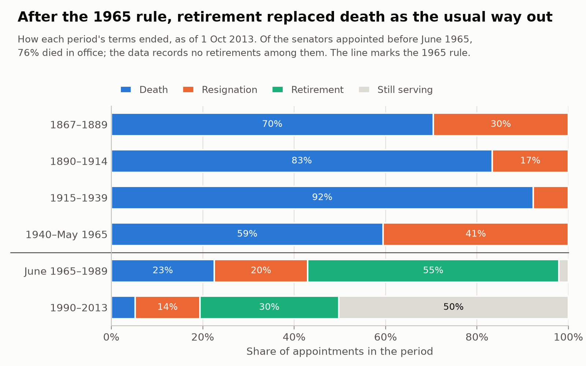

# How long do Canadian senators serve?

[](https://github.com/analystkumar29/senate-tenure-survival/actions/workflows/ci.yml)

A survival analysis of 930 Senate appointments from 1867 to 2013, and a worked example of why
cases that haven't finished yet (censored data) need special handling.

## The question

Canadian senators used to be appointed for life. Since 1965, new senators must retire at 75.
I wanted to answer a simple question properly: how long does a senator typically serve, and
has that changed?

The catch is that when this data was collected, 99 senators were still in office, so their
terms had no end date yet. How you treat those 99 people changes the answer, and that is
the main thing this project is about.

## Data and its limits

- **Source:** `lifelines.datasets.load_canadian_senators()`, a dataset that ships with the
  [lifelines](https://lifelines.readthedocs.io) Python package (version 0.30.3 here).
  lifelines describes it only as "a history of Canadian senators in office" and doesn't say
  where it came from.
- **Size:** 933 rows, one per appointment. I removed 3 people named at Confederation who
  declined the appointment (0 days in office). That leaves **930 appointments: 831 finished
  terms and 99 senators still serving.**
- **When it stops:** all 99 sitting senators have the same end date and time in the raw data
  (2013-10-01 22:20), which looks like the moment the data was collected. So the data stops on
  **1 October 2013**, and that is the censoring date. Nothing after it is included, so the
  data can't tell us how or when those 99 terms ended.
- **Rows are appointments, not people:** 933 rows carry 922 distinct names, because a few
  people were appointed more than once and a few different people share a name.
- **No ages:** there are no birth dates, so I can't model the age-75 rule directly. I can
  only compare appointments made before and after it.
- **Party** is the affiliation at appointment, grouped by name into Liberal, Conservative and
  Other. **Region** is Atlantic, Quebec, Ontario, or West & North (the 11 territorial
  appointments are too few to stand alone).
- I haven't checked the data row by row against official Senate records.

## Method

**Censoring:** for a senator still in office when the data stops, we don't know when the term
will end, only that it is longer than what we've seen so far. That is called right-censoring,
and the Kaplan–Meier method handles it by counting each sitting senator as "still serving" for
as long as we've seen them, instead of dropping them or pretending they left on the day the data
stopped.

I use Kaplan–Meier for median terms with 95% confidence intervals, log-rank tests to compare
groups, and a Cox proportional-hazards model to look at era, party and region together. The
code is plain pandas, lifelines and matplotlib.

## Findings

### 1. A typical senator serves about 14 years

The Kaplan–Meier median term is **14.0 years (95% CI 13.0–14.8)** across all 930
appointments.



### 2. Ignoring the senators still in office gets the answer wrong

Three ways to summarize the same data, all in years:

| | All appointments | Appointed before June 1965 | Appointed June 1965 or later |
|---|---|---|---|
| Still serving in Oct 2013 | 11% | 0% | 30% |
| Average of completed terms only | 14.5 | 15.2 | 12.6 |
| Average, sitting senators treated as leaving on 1 Oct 2013 | 13.8 | 15.2 | 11.4 |
| Median of completed terms only | 13.3 | 13.7 | 11.4 |
| Median, sitting senators treated as leaving on 1 Oct 2013 | 12.5 | 13.7 | 9.9 |
| **Kaplan–Meier median (95% CI)** | **14.0 (13.0–14.8)** | **13.7 (12.9–14.9)** | **14.2 (12.5–15.0)** |

An average and a median aren't the same thing: a few very long terms (up to 48.5 years) pull
the average above the median even when nothing is censored. So the fair comparison is median
against median.

- **Appointed before June 1965:** nobody was still serving, and all three medians agree
  (13.7). With no censoring, Kaplan–Meier is just the ordinary median.
- **Appointed June 1965 or later:** 30% were still serving. Dropping them gives 11.4 years.
  Cutting their terms off at the data date gives 9.9. Kaplan–Meier gives 14.2.

Both shortcuts make terms look shorter. Dropping sitting senators removes exactly the people
who are on track for long terms, and cutting them off counts unfinished terms as finished.
With either shortcut I would have "found" that the 1965 rule cut the typical term by two to
four years. The Kaplan–Meier medians show no such drop (finding 4).

### 3. Back-test: in 1990, Kaplan–Meier was within a year of the real answer

To check whether Kaplan–Meier is right and not just different, I rebuilt the data as it would
have looked on **1 January 1990**. By then, 142 appointments had been made under the retire-at-75
rule, and 86 of those senators (61%) were still serving.

| Estimate made on 1 Jan 1990 | Median term |
|---|---|
| Completed terms only | 8.9 years |
| Sitting senators treated as leaving on 1 Jan 1990 | 10.2 years |
| Kaplan–Meier | **15.8 years (95% CI 13.7–19.1)** |
| **What actually happened** | **15.0 years** |

By 2013 only 3 of those 142 senators were still serving, and each had already served more than
29 years, well past the median, so the real median is known. The shortcuts were too low by
about 6 and 5 years. Kaplan–Meier was 0.8 years high, and its interval contained the real value.



### 4. Before and after the 1965 rule: a similar typical term, but shorter longest terms

- Median term: **13.7 years (12.9–14.9)** for appointments before June 1965 vs **14.2
  (12.5–15.0)** after. A log-rank test finds no clear difference (**p = 0.28**).
- Share still serving after 20 years: 30.2% before vs 25.5% after. After 30 years: 8.5% vs
  8.1%. After 35 years: **4.5% vs 0.7%**. The longest term was **48.5 years** before the rule
  and **36.9** after.
- By appointment period (about 25 years each, with one boundary on the 1965 rule), every
  median falls between **11.6 and 15.0 years**, and a log-rank test across the six periods
  finds no clear difference (**p = 0.14**). The lowest, 1990–2013, is also the least certain:
  half that group was still serving.

That is the pattern an age cap would produce, but a before/after comparison can't prove the
rule caused it.





### 5. Era, party and region barely predict how long a senator serves

A Cox model with era, party family and region gives hazard ratios close to 1, and every 95%
interval includes 1. For example: appointed after the rule **1.11 (0.95–1.30)**, Conservative
vs Liberal **1.02 (0.88–1.17)**. The concordance is **0.53**, barely better than a coin flip,
and a likelihood-ratio test finds no evidence that the three factors together beat a model with
none (p = 0.53).

The proportional-hazards check flags two of the six coefficients at p = 0.02: West & North,
and the small "Other" party group (17 appointments). Stratifying by region (giving each region
its own baseline) leaves the other estimates almost unchanged (era 1.10, 0.94–1.29) and nothing
is flagged after that, so it doesn't change the conclusion. The missing piece is age at
appointment, which the data doesn't have.



### 6. After the 1965 rule, retirement replaced death as the usual way out

Of senators appointed before June 1965, **76% died in office** and the data records **no
retirements**. Of those appointed from June 1965 to 1989, **55% retired**, 23% died in office
and 20% resigned. Death, retirement and resignation are competing risks (a senator who retires
can no longer die in office), so I've kept this chart descriptive instead of fitting a separate
survival curve for each reason.



## How to run

Needs Python 3.12 (the version CI uses).

```bash
git clone https://github.com/analystkumar29/senate-tenure-survival.git
cd senate-tenure-survival
python3.12 -m venv .venv
source .venv/bin/activate
pip install -r requirements.txt

pytest                   # unit tests, plus tests/test_findings.py, which rechecks every number above
python make_figures.py   # rebuilds figures/ and prints the headline numbers
jupyter nbconvert --to notebook --execute --inplace analysis.ipynb   # re-runs the notebook
```

```
src/prep.py        load the data; durations in years, eras, periods, party families, regions; censor_at()
src/estimates.py   Kaplan–Meier medians, the naive shortcuts, the back-test, the Cox design
src/plots.py       the six charts (used by both the notebook and make_figures.py)
tests/             pytest tests for src/, and test_findings.py for the numbers in this README
analysis.ipynb     the full analysis with short explanations
make_figures.py    rebuilds figures/ without Jupyter
```

## What I'd do next

- Add **age at appointment** from the senators' official biographies. The 1965 rule works
  through age, so that is the variable that matters.
- Extend the data past 2013 and run a second back-test: check how the 99 sitting senators'
  terms actually ended.
- Do the competing-risks version properly, with a cumulative incidence (Aalen–Johansen)
  estimate for each way of leaving.
- Find out why resignations jump to 41% among senators appointed between 1940 and May 1965.
  59 of those 62 resignations happened after the 1965 rule came into force, and the data
  doesn't say why.

## Why this matters to me

In my own product, applications that haven't finished yet are right-censored in exactly this
way. Averaging only the finished ones would make waits look shorter than they are, for the same
reason the shortcuts above do, so the product uses a censoring-aware Kaplan–Meier model instead.
I wanted a small public example on open data that shows the problem and checks the method
against an answer we now know.

## Sources

- Data: the `canadian_senators` dataset in lifelines. Davidson-Pilon, C. (2019). lifelines:
  survival analysis in Python. *Journal of Open Source Software*, 4(40), 1317.
  https://doi.org/10.21105/joss.01317
- The 1965 rule: Constitution Act, 1867, section 29 and its endnote ("As enacted by the
  Constitution Act, 1965, S.C. 1965, c. 4, which came into force on June 2, 1965"), on the
  [Justice Laws Website](https://laws.justice.gc.ca/eng/const/endnotes.html).

Code is MIT licensed (see `LICENSE`).

More about me and my work: https://manojkumar-ca.vercel.app
